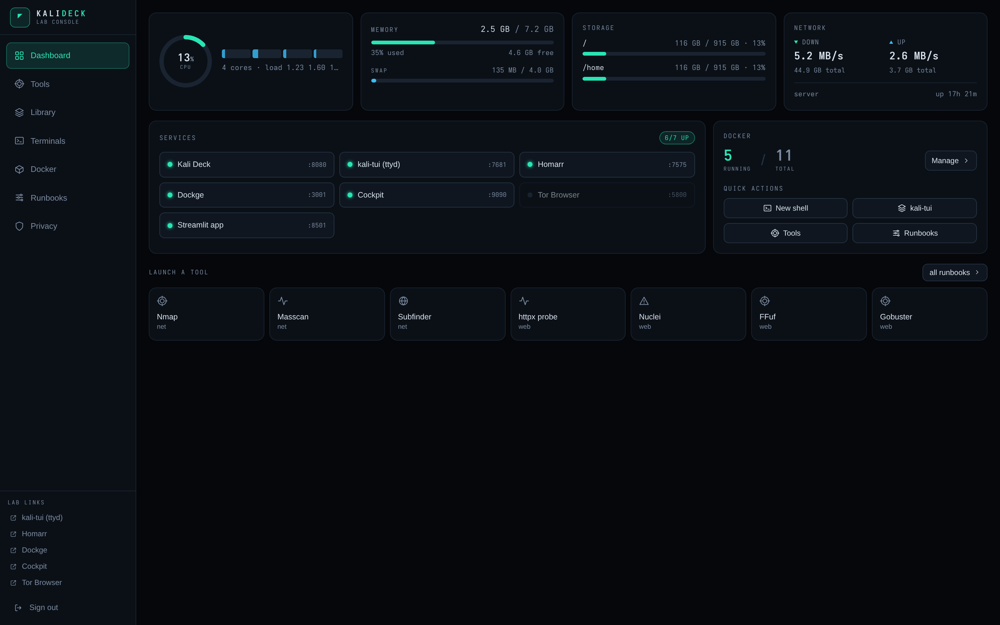
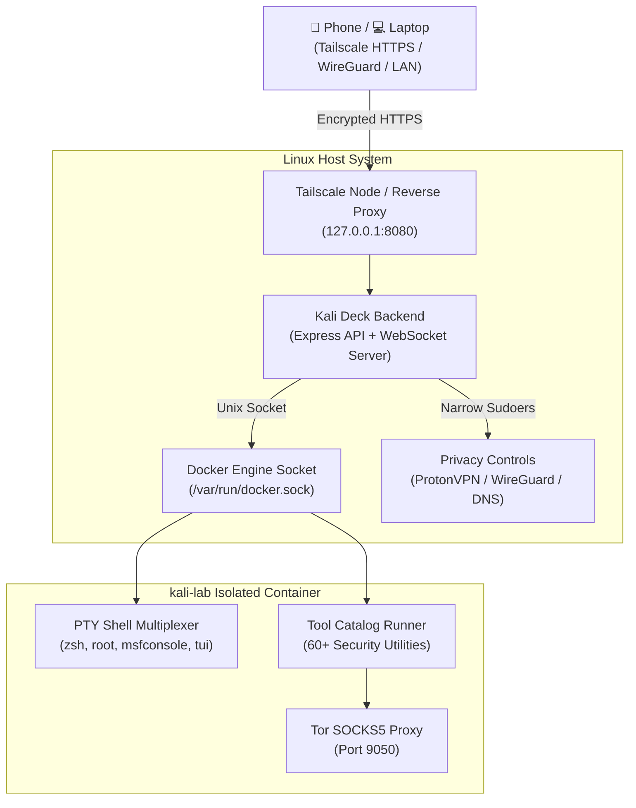
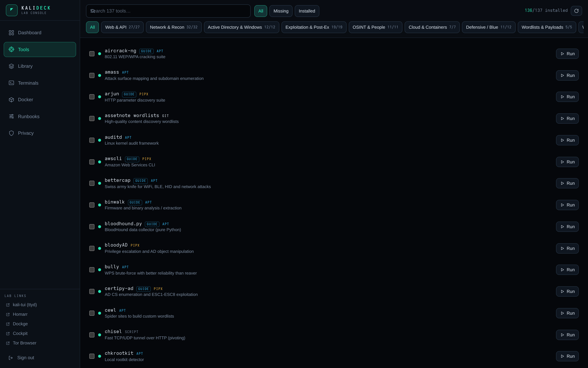
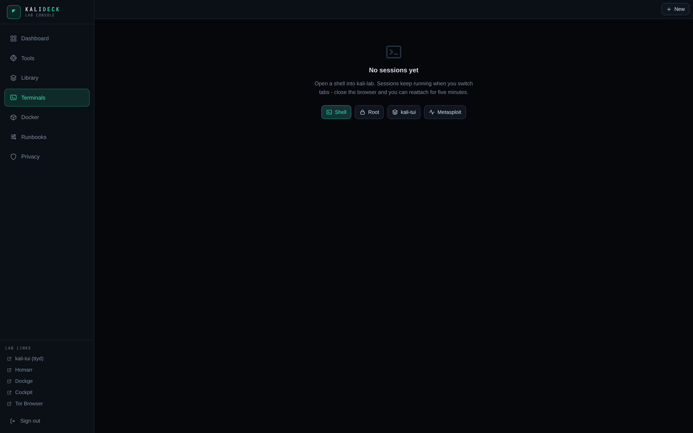
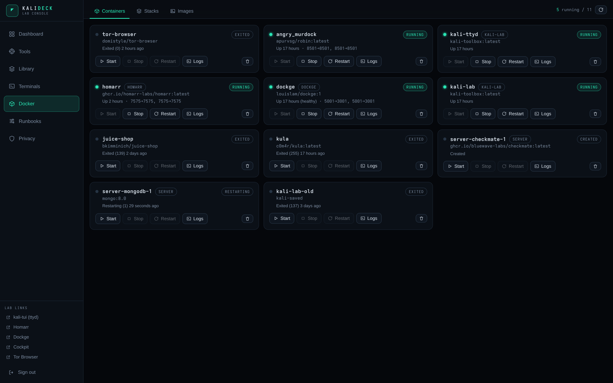
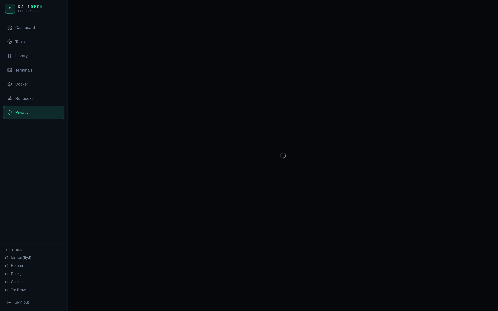

<div align="center">

# 🛡️ Kali Deck

### *A Self-Hosted, Phone-Friendly Web Console for a Containerized Kali Linux Lab*

[](https://www.kali.org/)
[](https://www.docker.com/)
[](https://react.dev/)
[](https://tailscale.com/)
[](LICENSE)

<br/>

```
  [ LIVE TERMINALS ]  •  [ 60+ TOOLS CATALOG ]  •  [ DOCKER MANAGEMENT ]  •  [ TOR / WIREGUARD PRIVACY ]
```

<br/>



</div>

---

> [!IMPORTANT]
> **Authorized Testing Only**: Kali Deck is built for security research, CTF competitions, and penetration tests on infrastructure you own or are explicitly authorized to test. Comply with all local and international laws.

---

## ⚡ 1-Command Quickstart

Deploy the complete Kali Deck stack on any Linux host in seconds:

```bash
git clone https://github.com/ayush-rdev/kalideck.git && cd kalideck && bash setup.sh
```

> **Automated Pipeline**: The setup script automatically verifies dependencies, configures Docker, pulls/builds the `kali-toolbox` container, builds the React PWA frontend, and enables a persistent systemd user service.

Once installed, visit `http://127.0.0.1:8080/` and retrieve your auto-generated credentials:

```bash
grep DECK_PASSWORD kali-deck/.env
```

---

## 📐 System Architecture

Kali Deck runs on the Linux host and orchestrates the isolated `kali-lab` container over the Docker UNIX socket. The browser never receives direct shell access to the host operating system.



---

## 📸 Interface & Capabilities

<div align="center">
<table>
  <tr>
    <td width="50%" align="center">
      <b>🛠️ Curated Tool Catalog & Recipes</b><br/><br/>
      
    </td>
    <td width="50%" align="center">
      <b>💻 Multi-Tab Real PTY Terminals</b><br/><br/>
      
    </td>
  </tr>
  <tr>
    <td width="50%" align="center">
      <b>🐳 Docker & Stacks Controller</b><br/><br/>
      
    </td>
    <td width="50%" align="center">
      <b>🛡️ Network Privacy & VPN/Tor Shield</b><br/><br/>
      
    </td>
  </tr>
</table>
</div>

### 1. 🛠️ Curated Security Catalog (~60 Tools)
* One-click recipe runners for Information Gathering, Vulnerability Scanning, Web App Analysis, Wireless Auditing, and Forensics.
* Live-streamed asynchronous installations via WebSocket jobs with persistent scrollback.

### 2. 💻 Server-Side PTY Multiplexer
* Full ANSI xterm.js terminals with persistent state across tab disconnects.
* Dedicated terminal pools for `zsh`, `root`, `msfconsole`, and custom ad-hoc commands.

### 3. 🐳 Container & Compose Management
* Monitor live CPU/memory metrics across lab containers.
* Follow container logs in real time, inspect image layers, and trigger restarts straight from your smartphone.

### 4. 🛡️ Tor & VPN Privacy Shield
* Toggle WireGuard interfaces and ProtonVPN profiles via tightly scoped sudoers rules.
* Transparent Tor SOCKS5 routing with automated DNS leak prevention.

---

## 🌐 Remote Access & Tailscale Integration

The backend binds exclusively to `127.0.0.1` for maximum security. Reach your lab anywhere securely:

### Option A: Tailscale HTTPS (Recommended)
```bash
sudo kali-deck/deploy.sh
# Generates a trusted HTTPS endpoint: https://<device>.<tailnet>.ts.net/
```

### Option B: Encrypted SSH Tunnel
```bash
ssh -N -L 8080:127.0.0.1:8080 user@<server-ip>
# Access securely via http://localhost:8080
```

---

## 🔒 Security Model

* **Session Hardening**: Sessions are protected by `HttpOnly; SameSite=Strict` cookies and authenticated in-memory with IP rate-limiting against brute force.
* **Non-Privileged Isolation**: The `kali-lab` container drops root privileges and retains only necessary capabilities: `NET_ADMIN`, `NET_RAW`, and `SYS_PTRACE`.
* **Zero Host Shell Access**: Command execution is confined strictly within Docker containers.
* **Narrow Sudo Privileges**: Host VPN controls utilize strict sudoers entries defined in [`setup-sudo.sh`](kali-deck/setup-sudo.sh), revocable at any time.

---

## 🧰 Extending the Lab

### Adding a New Security Tool
Append a definition to [`kali-lab/catalog.json`](kali-lab/catalog.json):
```json
{
  "id": "nuclei",
  "name": "Nuclei",
  "category": "vulnerability",
  "binary": "nuclei",
  "install": { "type": "go", "pkg": "github.com/projectdiscovery/nuclei/v3/cmd/nuclei@latest" },
  "recipes": [
    { "name": "Scan Target", "cmd": "nuclei -u {target} -t cves/" }
  ]
}
```

---

## 📄 License

Open-source software licensed under the **[MIT License](LICENSE)**.
Created with passion by [ayush-rdev](https://github.com/ayush-rdev).
